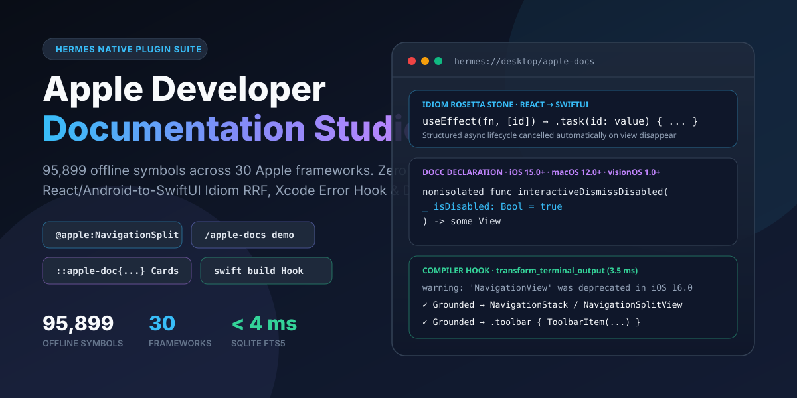
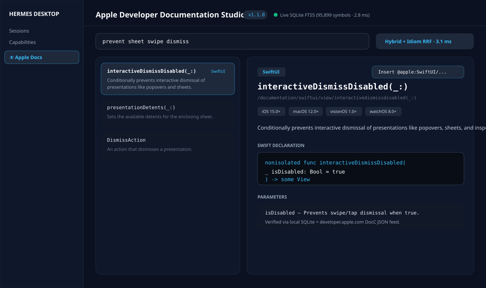
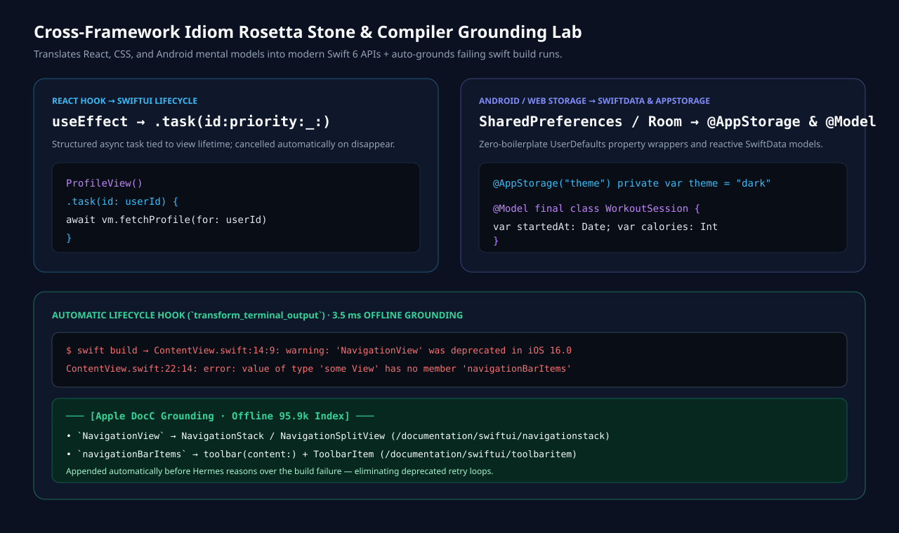
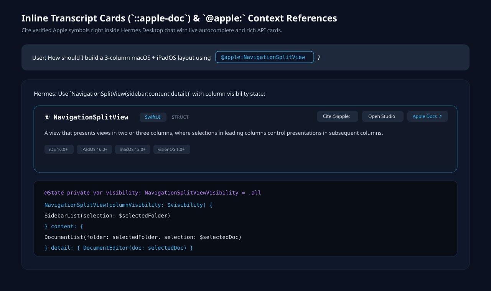

# Apple Developer Documentation Studio (`apple-doc-plugin`)



**Offline-first Apple Developer Documentation suite for Hermes Agent: 95,899 Apple SDK symbols across 30 frameworks, sub-5ms SQLite FTS5 search, React/Web/Android-to-SwiftUI Idiom RRF, automatic `swift build` compiler diagnostic grounding hook, `@apple:` context references, and a native Hermes Desktop Studio.**

Built for the **Hermes Agent Plugin Hackathon (November 2026)** · Requires Hermes Agent `>=0.22.5` · macOS, Linux, and Windows · Zero API keys required.

> **Judges, start here (2 seconds, zero API keys, zero Node setup needed):**
>
> 1. Enable `apple-doc-plugin` and run **`/apple-docs demo`** in any Hermes chat (or `hermes apple-docs demo` in CLI). It benchmarks wildcard FTS5 globbing (`Navigation*View`), React-to-SwiftUI idiom RRF (`useEffect` $\rightarrow$ `.task(id:_:)`), behavioral recall (`"prevent sheet swipe dismiss"` $\rightarrow$ `interactiveDismissDisabled(_:)`), and live compiler diagnostic grounding in **~85 ms**, rendering interactive `::apple-doc{...}` cards inline in Hermes Desktop.
> 2. Open ** Apple Docs** in the Hermes Desktop sidebar (`/apple-docs`) or click **` 95.9k Docs`** in the bottom statusbar to explore all 95,899 symbols, the Cross-Framework Idiom Rosetta Stone, and the interactive Xcode Compiler Error Lab.
> 3. Type **`@apple:NavigationSplitView`** or **`@apple:useEffect`** in any Hermes prompt to expand verified Apple DocC declarations straight into context.

---

## Why a Hermes Plugin (and Not a Prompt or Skill)

| Hermes Surface                                    | Registered Via                                                    | What It Does That a Skill Cannot                                                                                                                                                                                                                                                                        |
| :------------------------------------------------ | :---------------------------------------------------------------- | :------------------------------------------------------------------------------------------------------------------------------------------------------------------------------------------------------------------------------------------------------------------------------------------------------ |
| **Desktop Workspace Studio (`/apple-docs`)**      | `ROUTES_AREA` + `SIDEBAR_NAV_AREA` (`desktop/plugin.js`)          | Full 4-tab master-detail explorer over 95,899 symbols, interactive React/CSS/Android Rosetta Stone, and live Xcode compiler error simulator backed by `/api/plugins/apple-doc-plugin/*`.                                                                                                                |
| **Inline Transcript Cards (`::apple-doc{...}`)**  | `TRANSCRIPT_DIRECTIVE_AREA`                                       | Renders native interactive Apple API cards directly inside assistant messages with availability pills, 1-click `@apple:` citation, and DocC links.                                                                                                                                                      |
| **Dockable Right Inspector + Statusbar + `⌘K`**   | `PANES_AREA`, `STATUSBAR_AREAS.right`, `PALETTE_AREA`             | Persistent side-by-side API lookup drawer next to active coding sessions plus `⌘K` palette triggers.                                                                                                                                                                                                    |
| **Automatic Compiler Grounding Hook**             | `ctx.register_hook("transform_terminal_output")`                  | Intercepts failed `swift build`, `swift test`, `swiftc`, and `xcodebuild` runs (`returncode != 0`), extracts deprecated/missing Apple symbols (`NavigationView`, `navigationBarItems`, `foregroundColor`, etc.), and appends verified replacements in **~3.5 ms** before the LLM wastes turns guessing. |
| **`@apple:` Context Reference Provider**          | `ctx.register_context_reference`                                  | Adds `@apple:<symbol-or-idiom>` with live SQLite FTS5 + Idiom autocomplete across CLI, TUI, Desktop, and gateway chats.                                                                                                                                                                                 |
| **`/apple-docs` Slash & `hermes apple-docs` CLI** | `ctx.register_command` + `ctx.register_cli_command`               | Zero-LLM-cost instant lookup (`/apple-docs demo`, `/apple-docs idiom SharedPreferences`, `/apple-docs doc NavigationSplitView`).                                                                                                                                                                        |
| **6 Native Agent Tools + Bundled Skill**          | `ctx.register_tool` (`apple_docs` toolset) + `ctx.register_skill` | Sub-5ms Python `sqlite3` FTS5 fast-path (`semantic_search`, `search_symbols`, `get_documentation`, `discover_technologies`, `get_version`, `index_info`) with optional 768-d dense vector upgrade.                                                                                                      |

---

## Desktop Studio Preview







---

## Cross-Framework Idiom & Behavioral Recall

Developers and AI models frequently reason in React, CSS, or Android mental models, or describe desired UI behaviors rather than exact Apple symbol identifiers:

| Query / Mental Model                     | Naive Keyword Search | What `apple-doc-plugin` Returns                                         |
| :--------------------------------------- | :------------------- | :---------------------------------------------------------------------- |
| _"prevent sheet swipe dismiss"_          | 0 matches            | `interactiveDismissDisabled(_:)` (`SwiftUI`)                            |
| _"React useEffect equivalent"_           | 0 matches            | `task(id:priority:_:)`, `onAppear(perform:)`, `onChange(of:initial:_:)` |
| _"SharedPreferences"_ / _"localStorage"_ | 0 matches            | `@AppStorage`, `@SceneStorage`, `UserDefaults`                          |
| _"display: flex"_                        | 0 matches            | `HStack`, `VStack`, `ZStack`, `Spacer`, `Layout`                        |
| _"Android Room database"_                | Unrelated matches    | `@Model`, `ModelContainer`, `ModelContext`, `@Query` (`SwiftData`)      |
| _"dismiss keyboard on tap outside"_      | 0 matches            | `scrollDismissesKeyboardMode(_:)`, `@FocusState`                        |
| `Navigation*View` (wildcard)             | Literal failure      | `NavigationSplitView`, `NavigationView`                                 |

---

## Install & Usage in Hermes Agent

```bash
hermes plugins install apple-doc-plugin
hermes plugins enable apple-doc-plugin
```

### Slash Commands (In Any Hermes Session)

- `/apple-docs demo` — Run the 4-stage live benchmark + render inline `::apple-doc` cards
- `/apple-docs status` — Inspect offline symbol count, frameworks, and latency
- `/apple-docs idiom useEffect` — Translate React/Web/Android patterns to Swift 6 / SwiftUI
- `/apple-docs doc NavigationSplitView` — Fetch Swift declaration, availability, and parameters
- `/apple-docs search Grid*` — Wildcard FTS5 symbol search

### Inline `@apple:` Context References

Attach authoritative Apple documentation directly to any prompt:

- `Build a 3-column macOS document browser using @apple:NavigationSplitView`
- `Migrate this React component's @apple:useEffect and @apple:localStorage hooks to SwiftUI`
- `Store credentials securely in the Keychain with @apple:Security/SecItemAdd`

---

## Offline Index Coverage (95,899 Symbols)

The shipped read-only SQLite FTS5 index (`data/apple-docs.db`) covers **95,899 symbols** across Swift and Objective-C/C symbol trees with zero network setup required:

| Framework                  | Symbols | Framework               |                               Symbols |
| :------------------------- | ------: | :---------------------- | ------------------------------------: |
| **Swift**                  |  18,442 | **CoreData**            |                                 1,170 |
| **Foundation**             |  13,013 | **Combine**             |                                 1,062 |
| **AppKit**                 |  12,654 | **SwiftData**           |                                   552 |
| **UIKit**                  |  11,449 | **CoreLocation**        |                                   474 |
| **Security**               |   7,331 | **RegexBuilder**        |                                   462 |
| **SwiftUI**                |   7,202 | **LocalAuthentication** |                                   246 |
| **RealityKit**             |   6,235 | **Synchronization**     |                                   196 |
| **AVFoundation**           |   5,614 | **Distributed**         |                                    93 |
| **WebKit**                 |   3,193 | **BundleResources**     |                                    88 |
| **Vision**                 |   1,915 | **ObjectiveC**          |                                    77 |
| **StoreKit**               |   1,531 | **AVFAudio**            |                                    45 |
| **AuthenticationServices** |   1,473 | **Observation**         |                                    37 |
| **MapKit**                 |   1,299 | _+ cross-ref modules_   | _visionOS, WidgetKit, PassKit, AVKit_ |

---

## Configuration (`config.yaml`)

| Setting              | Type   | Default | Description                                                                                                            |
| :------------------- | :----- | :------ | :--------------------------------------------------------------------------------------------------------------------- |
| `compiler_grounding` | `bool` | `true`  | Append verified Apple DocC migration hints when `swift build`, `swift test`, `swiftc`, or `xcodebuild` exits non-zero. |
| `prefer_node_bridge` | `bool` | `false` | Route tool calls through the optional Node.js >= 22 MCP bridge even when dense vectors are not hydrated.               |

Optional secret (via Hermes profile `.env` / `agent.secret_scope.get_secret`): `GEMINI_API_KEY` (only used if opting into hosted `gemini-embedding-2` dense vector embedding in the Node runtime).

---

## Security & Behavior Disclosure (Catalog Rule 13)

- **Surfaces registered:** 6 tools (`search_symbols`, `semantic_search`, `get_documentation`, `discover_technologies`, `get_version`, `index_info`), 1 hook (`transform_terminal_output`), 1 slash command (`/apple-docs`), 1 CLI subcommand (`hermes apple-docs`), 1 context reference (`@apple:`), 1 bounded system-prompt guidance snippet (`apple-docs-directives`), 1 skill (`apple-docs`), 1 FastAPI router (`dashboard/plugin_api.py` under `/api/plugins/apple-doc-plugin/`), and 1 Desktop bundle (`desktop/plugin.js` using strictly `@hermes/plugin-sdk` and `react`).
- **Filesystem access:** Reads its own shipped `data/apple-docs.db` in read-only URI mode (`?mode=ro`). Writes no files during normal Hermes operation. In write-enabled Node hybrid mode, dense vectors hydrate into `data/apple-docs.runtime.db` (falling back to `$XDG_CACHE_HOME/apple-doc-plugin` if the bundle is read-only).
- **Network calls:** `search_symbols`, `semantic_search`, `discover_technologies`, `get_version`, `index_info`, `/apple-docs demo`, and the `transform_terminal_output` compiler hook are **100% offline**. Only `get_documentation` (and Desktop Studio symbol selection with `live=true`) performs an HTTPS `GET` to `https://developer.apple.com/tutorials/data/documentation/<symbol>.json` (strictly host-checked to `developer.apple.com`, 5s timeout, 2 MiB cap) to enrich offline metadata with full Swift declaration tokens, falling back to the local SQLite database if unreachable.
- **Subprocesses & credentials:** The default Python SQLite FTS5 engine spawns **no subprocesses** and requires **no credentials**. An optional Node.js (`>=22`) MCP child process (`bridges/hermes/hermes_bridge.py`) starts only if `prefer_node_bridge: true` is configured or dense vectors are hydrated in `apple-docs.runtime.db`; if `GEMINI_API_KEY` is configured, it is read exclusively via `agent.secret_scope.get_secret("GEMINI_API_KEY")`.
- **Telemetry:** None. No analytics, tracking, or third-party endpoints.
- **Prior art & pre-existing work:** Authored by Andrew Mason (`AndrewMason7`). Tool naming conventions originally inspired by `MightyDillah/apple-doc-mcp`; the 95,899-symbol SQLite FTS5 corpus, cross-framework idiom RRF engine, Python native engine, compiler diagnostic hook, `@apple:` context reference provider, and Hermes Desktop Studio were built for `apple-doc-plugin` (with the full Hermes native Desktop/Hook/Directive/Context-Reference suite built for the November 2026 Hackathon).

---

## License

[MIT](LICENSE) © 2026 Andrew Mason
