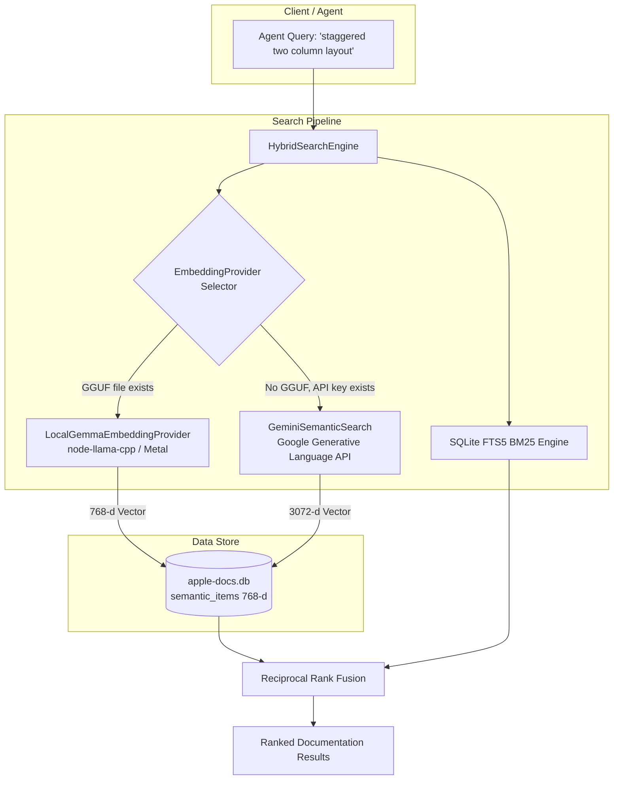

# In-Process Local EmbeddingGemma 2 via node-llama-cpp — Design Spec

## 1. Overview & Intent

Currently, `apple-doc-plugin` utilizes Google Gemini (`models/gemini-embedding-2`) for vector embeddings during indexing and semantic query execution. While effective, this creates an external dependency on Google AI Studio API keys, Google Cloud ADC authentication, and network availability.

This specification designs a **100% offline, in-process local embedding backend** powered by `node-llama-cpp` and Google DeepMind's **EmbeddingGemma 2** (`embeddinggemma-2-Q8_0.gguf`):

1. **In-Process Inference**: Runs directly inside the MCP server via `node-llama-cpp` with Apple Silicon Metal acceleration—no external server daemons (LM Studio, Ollama) required.
2. **Unified Prompt Format**: EmbeddingGemma 2 shares the exact asymmetric prompt engineering architecture developed for Gemini (`task: search result | query: ...` and `title: ... | text: ...`).
3. **Optimized Dimensionality**: Generates 768-dimensional embeddings (compared to Gemini's 3072-d), cutting SQLite storage for `semantic_items` by 4x and speeding up vector cosine similarity computations.
4. **Pluggable Architecture**: Introduces a unified `EmbeddingProvider` interface with automatic provider discovery:
   - **Local GGUF** (Default when local GGUF model is present)
   - **Gemini Cloud** (Fallback when `GEMINI_API_KEY` or ADC credentials are present)
   - **Lexical FTS5** (Graceful fallback when neither is configured or upon error)

---

## 2. Architecture & Component Decomposition



---

## 3. Interfaces & Contracts

### 3.1 `EmbeddingProvider` Interface

```typescript
export interface EmbeddingProvider {
	readonly id: 'local-gguf' | 'gemini';
	readonly dimensions: number;
	isAvailable(): boolean;
	embedQuery(text: string): Promise<Float32Array | null>;
	embedDocument(content: string, title?: string): Promise<Float32Array | null>;
}
```

### 3.2 `LocalGemmaEmbeddingProvider` Implementation

- **Dependencies**: `node-llama-cpp`
- **Default Model Path**:
  - `process.env.APPLE_DOCS_EMBEDDING_MODEL_PATH`
  - Fallback: `/Users/andrew/Documents/GitHub/Models/embeddinggemma-2-Q8_0.gguf`
- **Lifecycle**: Lazy singleton initialization of `getLlama()`, `LlamaModel`, and `LlamaEmbeddingContext`.
- **Formatting**:
  - `embedQuery`: `task: search result | query: ${text.trim()}`
  - `embedDocument`: `title: ${title || 'none'} | text: ${content.trim()}`
- **Normalization**: Returns L2-normalized `Float32Array` of 768 dimensions.

---

## 4. Database & Compatibility

1. **Dimension Agnostic Storage**: The SQLite `semantic_items` table stores vector embeddings as a raw `BLOB` (`Float32Array`).
2. **Dynamic Ingestion**: `database.ts` deserializes Float32Array buffers and calculates magnitude/norms dynamically regardless of vector length (768 or 3072).
3. **Index Rebuilding**: Running `npm run build:index` with the local model active rebuilds `semantic_items` with 768-d EmbeddingGemma vectors.

---

## 5. Goals, Non-Goals & Constraints

### Goals

- 100% offline in-process semantic search using `embeddinggemma-2-Q8_0.gguf`.
- Sub-15ms vector query execution on Apple Silicon Metal.
- Zero breaking changes to `search_symbols` (pure lexical FTS5).
- Seamless fallback to Gemini API (if credentials present) or Lexical FTS5 (if offline and no model).

### Non-Goals

- Text generation / LLM completions (this is an embedding model only).
- Packaging the 310MB GGUF into the npm bundle (referenced via path/environment variable).

### Constraints

- Node.js 20+ on macOS arm64.
- Graceful error boundary: if `node-llama-cpp` cannot compile or load the model, cleanly fall back to lexical search without throwing unhandled exceptions.
